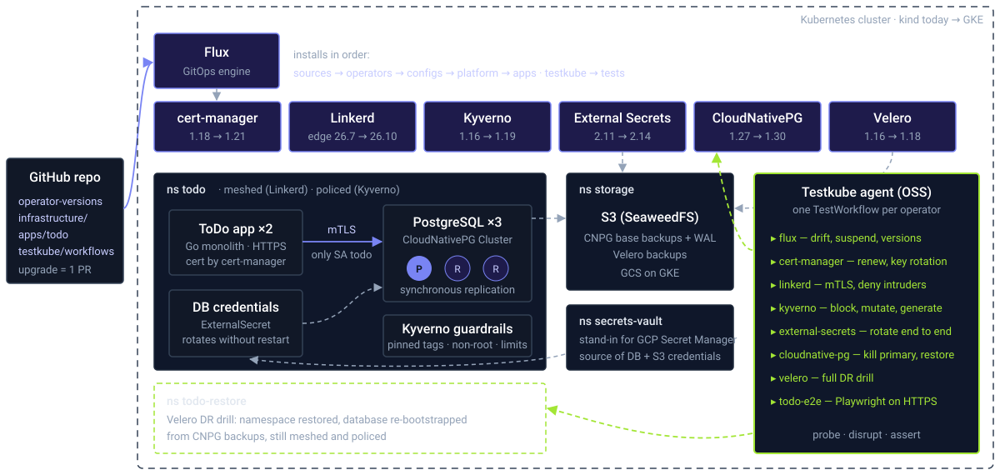

<!-- _class: lead -->
<!-- _paginate: false -->

# Testing Kubernetes operators<br>beyond green lights

Six operators, one app, one upgrade PR, and what Testkube found

<!--
Speaker notes: In this talk we upgrade six operators with one Git commit and let Testkube tell us what actually broke, beyond what the operators themselves report.
-->

---

<p class="eyebrow">The problem</p>

## "All pods Running" is not a test

- Platforms run on **operators**: certificates, mesh, policies, secrets, backups, databases
- Operators upgrade often, and their **behaviour** changes: defaults, APIs, permissions
- Health checks answer *is it alive?* They don't answer *does it still do its job for my app?*

> Today: upgrade **6 operators** at once through GitOps, and let **Testkube** test what each one is *for*.

<!--
Health checks and green dashboards only tell you the controller pod is alive. Our questions are about behaviour: does certificate renewal still rotate keys, does the mesh still deny intruders, does failover still lose zero writes?
-->

---

<!-- _class: diagram -->

## Demo architecture



<!--
Walk the diagram left to right.
1. Everything comes from one Git repo; Flux installs it in ordered layers.
2. Six operators, all pinned 2 to 3 releases behind the latest. The arrows show the upgrade we will do.
3. The ToDo app: a Go monolith over HTTPS (cert-manager) talking mTLS to a 3-instance Postgres (CloudNativePG). Only the app's identity may reach the database (Linkerd). Credentials come from a vault through External Secrets. Kyverno polices the namespace.
4. Backups go to an in-cluster S3. Velero restores the whole namespace into todo-restore as a DR drill.
5. On the right, the Testkube agent with one TestWorkflow per operator. They probe, disrupt and assert.
-->

---

<p class="eyebrow">Who does what</p>

## Every operator has a job in the app

| Operator | Its job for the ToDo app | Pinned → target |
|---|---|---|
| **Flux** | Installs everything from Git; an upgrade is a PR | v2.10 |
| **cert-manager** | App HTTPS cert, Linkerd trust anchor + issuer | 1.18 → 1.21 |
| **Linkerd** | mTLS everywhere; only the app may reach Postgres | edge-26.7 → 26.10 |
| **Kyverno** | Pinned tags, non-root, limits, mesh required, seccomp, quota | 1.16 → 1.19 |
| **External Secrets** | DB and S3 credentials from the "vault" | 2.11 → 2.14 |
| **CloudNativePG** | 3 instances, synchronous replication, S3 backups, business metrics | 1.27 → 1.30 |
| **Velero** | Namespace disaster recovery | 1.16 → 1.18 |

<!--
Linkerd note: open-source stable releases stopped at 2.14, so OSS users live on the edge channel. That alone is a good reason to test every upgrade.
-->

---

<p class="eyebrow">Step 1 · The platform</p>

## One file decides every version

```yaml
# clusters/kind/operator-versions.yaml
data:
  CERT_MANAGER_VERSION: v1.18.6          # app v1.18.6
  LINKERD_VERSION: 2026.7.2              # edge-26.7.2
  KYVERNO_VERSION: 3.6.4                 # app v1.16.4
  EXTERNAL_SECRETS_VERSION: 2.11.0       # app v2.11.0
  VELERO_VERSION: 10.1.3                 # app v1.16.2
  CNPG_VERSION: 0.26.1                   # app v1.27.1
```

```sh
make status        # every Flux Kustomization Ready, HelmReleases at the pinned versions
```

<!--
Flux substitutes these into the HelmReleases. The tests read the same ConfigMap to assert that what runs is what Git asked for.
-->

---

<p class="eyebrow">Step 2 · The app</p>

## A ToDo app that touches all six operators

<div class="cols">
<div>

```sh
make app   # https://localhost:8443
kubectl -n todo get pods
```

```text
todo-6497fc44df-cs77n   2/2  Running
todo-6497fc44df-jfqkm   2/2  Running
todo-db-1               2/2  Running
todo-db-2               2/2  Running
todo-db-3               2/2  Running
```

</div>
<div>

- **2/2**: every pod carries a Linkerd proxy
- Padlock: cert from the demo CA (cert-manager)
- Password: from the vault (External Secrets)
- Namespace: label `policy=enforced` (Kyverno)
- Data: 3-instance Postgres (CloudNativePG)

</div>
</div>

<!--
Add two or three todos live. They will show up later in the restore drill and in the business metric.
-->

---

<p class="eyebrow">Step 3 · Green baseline</p>

## What the TestWorkflows prove

| Workflow | Beyond the green lights |
|---|---|
| `flux` | HelmReleases at the Git version · drift reverted · suspend honoured |
| `cert-manager` | Chain + SANs + served cert · renewal **rotates the key**, app serves it without restart |
| `linkerd` | DB sees mTLS from the app identity · **wrong SA and unmeshed pods denied** |
| `kyverno` | Each Enforce policy blocks its violation · mutate · generate · no deprecated API |
| `external-secrets` | Rotation reaches Secret → **Postgres role** → app; old password rejected |
| `cloudnative-pg` | Business metric correct · **kill primary under load: 0 writes lost** · restore |
| `velero` | Full DR drill into `todo-restore`: data, mesh and policies come back |
| `todo-e2e` | Playwright through the HTTPS UI |

<!--
Run make test. While it runs, explain that the tests disturb the environment on purpose, so they run one at a time.
-->

---

<p class="eyebrow">Step 3 · Green baseline</p>

## `make test` on the pinned versions

<div class="cols">
<div>

```text
flux               PASSED
cert-manager       PASSED
linkerd            PASSED
kyverno            PASSED
external-secrets   PASSED
cloudnative-pg     PASSED
velero             PASSED
todo-e2e           PASSED
```

</div>
<div class="card">

### cloudnative-pg, for example

```text
✅ cnpg_todo_items_open=832 matches the app
✅ a replica was promoted
✅ failover took 7s (limit 60s)
✅ all 398 acknowledged writes are
   on the new primary todo-db-2
✅ recovered 1231 rows from a fresh backup
```

</div>
</div>

<!--
Open one execution log. The interesting lines are the failover time and the zero lost writes, which the operator itself never reports.
-->

---

<p class="eyebrow">Step 4 · The upgrade</p>

## One pull request, six operators

```sh
make upgrade          # opens PR "Upgrade operators to their latest releases"
gh pr merge --merge   # Flux picks it up from main
```

<div class="cols">

```diff
- CERT_MANAGER_VERSION: v1.18.6
- LINKERD_VERSION: 2026.7.2
- KYVERNO_VERSION: 3.6.4
- EXTERNAL_SECRETS_VERSION: 2.11.0
- VELERO_VERSION: 10.1.3
- CNPG_VERSION: 0.26.1
```

```diff
+ CERT_MANAGER_VERSION: v1.21.3
+ LINKERD_VERSION: 2026.10.1
+ KYVERNO_VERSION: 3.9.2
+ EXTERNAL_SECRETS_VERSION: 2.14.0
+ VELERO_VERSION: 12.2.1
+ CNPG_VERSION: 0.29.1
```

</div>

<p class="muted">Within ~5 minutes: CNPG, External Secrets, Kyverno and the Linkerd CRDs are upgraded, and cert-manager is rejected.</p>

<!--
This is the moment most teams would look at the dashboard, see mostly green, and move on.
-->

---

<p class="eyebrow">Step 5 · Act 1</p>

## Same tests, after the upgrade

| Workflow | Result | Real upstream change |
|---|---|---|
| `flux` | <span class="bad">✗</span> 3 operators not at the Git version | One rejected upgrade blocks the dependent layers |
| `cert-manager` | <span class="bad">✗</span> still 1.18.6 | 1.21 removed `prometheus.servicemonitor.targetPort/path`; schema rejects values |
| `linkerd` | <span class="bad">✗</span> control plane still 26.7 | Blocked behind cert-manager |
| `kyverno` | <span class="warn">✗</span> deprecated API | 1.19 deprecates `ClusterPolicy` (removal planned for 1.20) |
| `cloudnative-pg` | <span class="bad">✗</span> metric gone, cluster "healthy" | Exporter now connects as `cnpg_metrics_exporter` |
| `velero` | <span class="bad">✗</span> still 1.16 | Blocked behind cert-manager |
| `external-secrets` · `todo-e2e` | <span class="ok">✓</span> | Safe for this app, which is useful to know too |

<!--
Two kinds of findings: upgrades that never happened (and GitOps quietly stalled), and upgrades that happened but changed behaviour.
-->

---

<p class="eyebrow">Finding · GitOps cascade</p>

## One bad value froze half the platform

<div class="cols">
<div>

```text
❌ FINDING: cert-manager/cert-manager is not
   running the version declared in Git
   (desired v1.21.3, deployed v1.18.6)
  Ready=False UpgradeFailed:
  values don't meet the specifications
  of the schema(s) ...
```

</div>
<div>

- cert-manager 1.21 removed two Helm values we had set
- Flux `dependsOn`: **operators → configs → platform**
- So Linkerd's control plane and Velero were **never even attempted**
- Every pod is still Running

</div>
</div>

> The `flux` workflow compares *what runs* with *what Git declares*, for every operator.

<!--
Nobody gets paged for this: nothing crashed. The cluster just silently stays on old versions.
-->

---

<p class="eyebrow">Finding · Silent behaviour change</p>

## The cluster is healthy, but the metric is gone

```text
❌ FINDING: custom metric cnpg_todo_items_open is missing:
   dashboards/alerts on open todos are blind (the operator still reports healthy)

failed to connect to `user=cnpg_metrics_exporter database=todo`:
FATAL: permission denied for database "todo"
```

- CNPG 1.28.3 / 1.29.1: the exporter stopped connecting as `postgres` and now uses a `pg_monitor`-only role
- Our hardening, `REVOKE CONNECT ON DATABASE todo FROM PUBLIC`, now locks it out
- `kubectl get cluster` still says **Cluster in healthy state**

<!--
This is the best example of beyond green lights: the operator is healthy, Postgres is healthy, but the business metric your alerting depends on has silently disappeared.
-->

---

<p class="eyebrow">Finding · Early warning</p>

## Works today, breaks on the next upgrade

```text
❌ FINDING: our policies (kyverno.io/v1) are written against a deprecated API:
kyverno.io/v1 ClusterPolicy is deprecated and will be removed in a future release;
migrate to ValidatingPolicy, MutatingPolicy, GeneratingPolicy or ImageValidatingPolicy
```

- Every Kyverno behaviour test still passes: blocks, mutates, generates
- The test re-applies the live policies as a server-side dry run and **collects API warnings**
- The migration becomes a planned task, before Kyverno 1.20 turns it into an incident

---

<p class="eyebrow">Step 6 · Act 2</p>

## Fix forward, and find the next one

<div class="cols">
<div>

```diff
   prometheus:
     enabled: true
     servicemonitor:
       enabled: false
-      targetPort: 9402
-      path: /metrics
```

<span class="ok">✓</span> cert-manager 1.21 and Linkerd edge-26.10 roll out<br>
<span class="ok">✓</span> `cert-manager` and `linkerd` go green

</div>
<div>

```text
Helm upgrade failed for release velero/velero
with chart velero@12.2.1:

BREAKING: The config values passed contained
no longer accepted options.

ERROR: restic uploaderType was removed,
please use a different one
```

<span class="bad">✗</span> Velero 1.17 removed Restic

</div>
</div>

<!--
Upgrades are layered: fixing one blocker reveals the next. The tests make each layer visible instead of guessing.
-->

---

<p class="eyebrow">Bonus</p>

## Found while building, on the old versions

<div class="cols">
<div class="card">

### Metric never exported
The CNPG exporter queried as `pg_monitor`, which could not read the app table. The cluster reported healthy the whole time.

</div>
<div class="card">

### Restore "succeeded", database never came back
Velero restored CNPG-owned Services and Secrets, and CNPG refuses to adopt them. Fix: exclude what the operator generates.

</div>
<div class="card">

### Restore needed retries
The base backup's last WAL was not archived yet. The test now waits for it before backing up.

</div>
<div class="card">

### GitOps stalled for 10 minutes
Dependent Kustomizations only retried on their full interval. Fix: `retryInterval: 1m`.

</div>
</div>

---

<p class="eyebrow">Takeaways</p>

## Test what each operator is *for*

- **Assert behaviour, not liveness**: rotate, renew, kill, restore, deny
- **Compare what runs with what Git declares**: GitOps can stall silently
- **Collect deprecations** before they become outages
- **Same tests, every upgrade**: the PR is the trigger, Testkube is the evidence
- Next: the same repo on **GKE** (GCP Secret Manager, GCS), with tests running on every upgrade PR

<!--
Close with: everything is in one repo; the tests are plain TestWorkflows you can copy for your own operators.
-->

---

<!-- _class: lead -->
<!-- _paginate: false -->

# Thank you

`testkube.io` · `docs.testkube.io`

Demo repo: `testkube-operators-demo`
